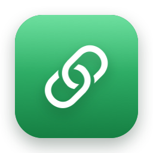
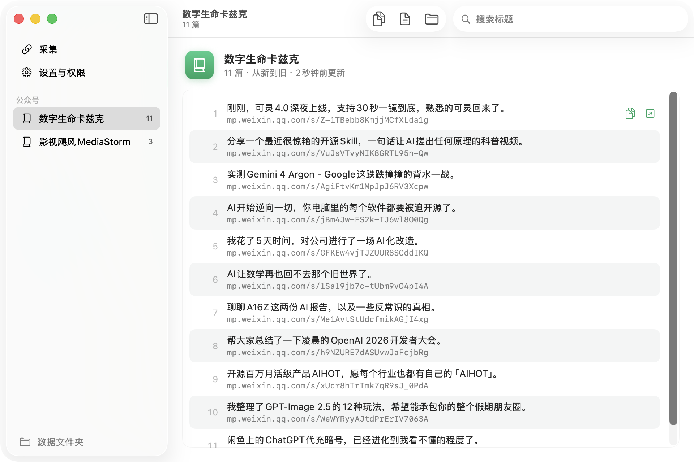
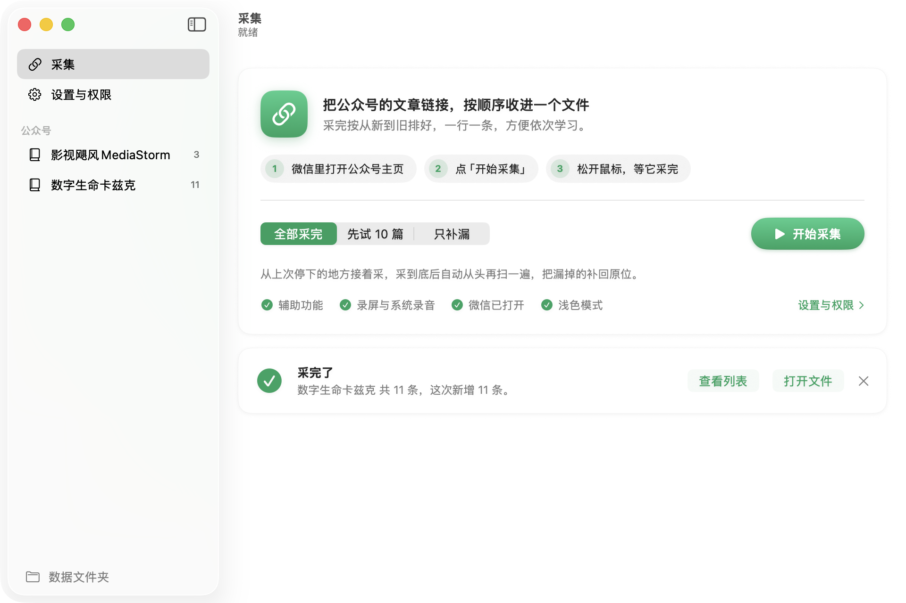
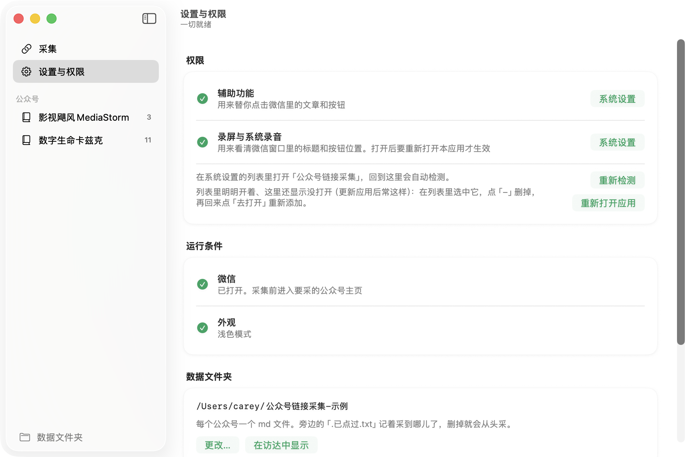

<p align="center"></p>

<h1 align="center">公众号链接采集</h1>

<p align="center">把一个公众号的文章链接，按顺序收进一个 md 文件，方便依次学习。<br>
macOS 小工具，开源免费。</p>

<p align="center">
  <a href="https://carey314.github.io/wechat-article-links/"><b>下载页</b></a> ·
  <a href="https://github.com/carey314/wechat-article-links/releases/latest">最新版本</a> ·
  <a href="#常见问题">常见问题</a>
</p>

<p align="center"></p>

## 它做什么

在微信桌面版里，照着你手动操作的样子逐篇处理：点开文章 → 点右上角「···」→「复制链接」→ 关掉，
把链接按公众号主页的顺序（从新到旧）一行一条写进 md。

- 一个公众号一个文件，文字帖也能采
- 采到底以后自动从头再扫一遍，漏掉的补回原位；已经有的不会重复写
- 停了再开始，从停下的地方接着采
- 误碰鼠标会暂停，停手 5 秒自动继续；鼠标甩到屏幕左上角立即停止
- 应用里能搜标题、双击用浏览器打开、一键复制全部链接
- 全程在本机完成：认字用 macOS 自带的文字识别，不联网、不调用 AI 服务

## 下载安装

打开 [下载页](https://carey314.github.io/wechat-article-links/)，或者在 [Releases](https://github.com/carey314/wechat-article-links/releases/latest) 下载 `WXLinks-mac.dmg`。
Apple 芯片和 Intel 的 Mac 都能用，需要 macOS 14 或更新。

1. 打开 dmg，把「公众号链接采集」拖进「应用程序」
2. 第一次打开系统会拦一下（没有付费签名）：点「完成」，然后打开 **系统设置 → 隐私与安全性**，在「安全性」里点 **仍要打开**
3. 应用里点「设置与权限」，打开 **辅助功能** 和 **录屏与系统录音** 两个权限，再点「重新打开应用」

如果提示「已损坏，无法打开」，在终端运行下面这行再打开：

```
xattr -dr com.apple.quarantine /Applications/公众号链接采集.app
```

## 用法

1. 在微信桌面版里打开要采的公众号主页（有「全部 / 贴图 / 文章 / 视频号」那页）
2. 应用里选范围（全部采完 / 先试 10 篇 / 只补漏），点「开始采集」
3. 松开鼠标，等它采完。每篇大约 4 秒

采到的链接默认存在 `文稿/公众号链接采集/<公众号名>.md`，可以在「设置与权限」里改。
旁边的 `<公众号名>.md.已点过.txt` 记着采到哪儿了，删掉就会从头采。

<p align="center"> </p>

## 常见问题

**会不会被封号？** 自动操作微信不符合微信的用户协议，存在被限制账号的可能，请自行判断、自担风险。
工具每篇之间会停顿、每 40 篇歇半分钟，但不能保证没有风险。

**为什么要用浅色模式？** 程序靠颜色认出微信标签栏里当前打开的是哪一页，目前只适配了浅色模式。

**采集时能用电脑做别的事吗？** 不能。它要用鼠标操作微信、靠截屏看画面，微信要在最前面、不能被挡住。

**更新版本后权限还要重新开吗？** 不用。如果系统设置里开着、应用里却显示没打开，在列表里选中它点「−」删掉，再回应用点「去打开」。

**有 Windows 版吗？** 正在做。

## 怎么工作的

微信内置浏览器不对外暴露页面内容，文章链接也不显示在页面上，只能点开文章后从「···」→「复制链接」拿到。
所以程序走的是界面操作这条路：

- **看**：截取微信窗口，用 macOS 的 Vision 文字识别认出每张卡片的标题和阅读数，按位置算出点哪儿；用标签栏的底色认出当前打开的是哪一页
- **点**：模拟鼠标点击和滚动。打开文章后等标签从「微信公众平台」换成文章标题（加载完）再点「···」，网络慢时最多等 30 秒，超时的留到补漏那遍再试
- **核对**：每篇打开后核对标签标题和要点的卡片是不是同一篇；翻页距离按这一屏卡片的实际位置算，并按上一次实际移动的距离校准，不会翻过头漏掉卡片

## 自己编译

需要 Xcode（或命令行工具 + actool），macOS 14 SDK 以上。

```
tools/build.sh            # 本机用，只编 Apple 芯片，输出 output/公众号链接采集.app
tools/build.sh release    # Apple 芯片 + Intel 通用版，并打成 output/WXLinks-mac.dmg
```

| 路径 | 内容 |
|---|---|
| `Sources/App/` | 窗口界面（SwiftUI）：`WXLinksApp.swift` 入口，`Model.swift` 状态和启动引擎，`Views.swift` 界面 |
| `Sources/engine.swift` | 采集引擎（命令行程序）：截屏认字、控制鼠标、写 md。界面在后台启动它，靠 `status.json` 和日志显示进度 |
| `Resources/` | 应用图标、强调色 |
| `tools/` | 编译打包脚本、图标生成、安装包里的说明 |
| `site/` | 下载页，推到 main 后自动发布到 GitHub Pages |

- 签名用临时签名（ad-hoc），并把认证要求设成只认程序标识，所以重新编译后系统权限不会失效
- 签名标识必须是英文：中文标识会让系统文字识别一直报错（`build.sh` 已处理）
- 调试：`output/公众号链接采集.app/Contents/MacOS/wxlinks-engine --probe` 只看不点，打印认到的标签、卡片和翻页计划
- 发布：推一个 `v` 开头的 tag（如 `v1.0.1`），GitHub Actions 会编译通用版并发到 Releases

## 协议

[MIT](LICENSE)。仅供个人学习整理使用，文章版权归原作者。
